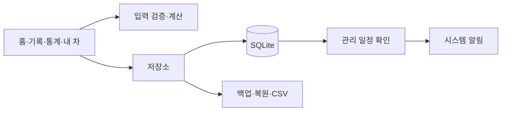

# 차곡 : 주유부터 정비까지

**첫차의 주유·정비·유지비를 차곡차곡.**

차량 정보를 등록하고 지출과 관리 일정을 남기는 Android 앱입니다. 실제로 결제한 금액과 다음에 해야 할 관리를 한곳에서 확인하도록 만들었습니다.

이 저장소는 **앱 구조·개발 과정·선별한 Kotlin 예제**를 공개하는 자료입니다. 전체 앱을 빌드하는 프로젝트는 포함하지 않습니다. 문서 기준일: 2026-10-27.

## 사용 흐름

1. 차량 이름·연료·연식·현재 주행거리를 입력합니다.
2. 주유·충전 또는 정비 후 날짜와 결제금액을 기록합니다.
3. 필요하면 주행거리·수량·장소·메모를 더합니다.
4. 홈과 통계에서 월 유지비와 예산을 확인합니다.
5. 날짜 또는 목표 주행거리로 관리 일정을 등록하고 완료합니다.
6. JSON 백업·복원과 CSV 내보내기로 기록을 보관합니다.

## 화면 구성

| 화면 | 역할 |
|---|---|
| 홈 | 현재 주행거리, 월 지출, 빠른 입력, 임박 일정, 최근 기록 |
| 기록 | 이름·장소·메모 검색, 항목 필터, 수정·삭제 |
| 통계 | 월별 지출, 항목별 비중, 6개월 변화, 월 예산, 주유·충전 단가 |
| 내 차 | 차량 정보, 관리 일정, 백업·복원·CSV, 알림 설정 |

오프화이트와 짙은 녹색, 얇은 구분선을 사용해 금액과 기록을 먼저 읽도록 구성했습니다. 입력 시트와 하단 네 메뉴로 이동 단계를 줄였습니다.

## 데이터를 다루는 원칙

- 보험료·세금도 실제 결제한 달의 지출에 포함합니다.
- 금액을 정수 `Long`으로 저장합니다.
- 과거 기록이나 삭제 때문에 현재 주행거리가 자동으로 내려가지 않습니다.
- 관리 일정의 완료와 실제 정비 지출을 구분합니다.
- 현재 주행거리는 수동 기록이며 GPS로 주행을 자동 추적하지 않습니다.
- 복원할 데이터를 검증한 뒤 SQLite 트랜잭션으로 교체합니다.

## 구조 둘러보기



| 문서 | 내용 |
|---|---|
| [앱 구조](docs/ARCHITECTURE.md) | 화면·검증·저장·일정의 연결 |
| [개발 과정](docs/DEVELOPMENT.md) | 첫차 관리 요구에서 데이터 규칙과 UI 개선까지 |
| [Kotlin 예제](examples/CarExamples.kt) | 월 합계, 남은 하루 예산, 임박 일정의 축약 예제 |
| [검증 범위](docs/VALIDATION.md) | 공개 예제와 기존 제품 테스트 기록의 구분 |
| [공개 범위](PUBLIC_SCOPE.md) | 포함·제외 항목, 권리와 기여 안내 |

## 기술

Kotlin / Android Views·Material / SQLiteOpenHelper / Java Time / JobScheduler / 시스템 문서 선택기. Android 8.0 이상을 대상으로 합니다.

기록은 로그인·자체 서버 없이 기기에 저장합니다. 원본 앱에는 별도 광고 모듈이 있으며 이 저장소에는 광고 코드와 식별자를 넣지 않았습니다. 광고 SDK의 네트워크 처리는 로컬 기록 저장과 별개의 영역입니다.

## 예제 실행

JDK 17 이상과 Kotlin/JVM 컴파일러가 설치된 환경에서 저장소 루트에서 실행합니다.

```sh
kotlinc examples/CarExamples.kt -include-runtime -d /tmp/chagok-examples.jar
java -jar /tmp/chagok-examples.jar
```

Windows에서는 출력 경로를 임시 디렉터리의 `.jar` 경로로 바꾸면 됩니다. Android SDK나 광고 SDK 없이 실행합니다. 가상 데이터만 사용하며 제품의 전체 계산·DB 스키마·알림 구현은 포함하지 않습니다.

관련 프로젝트: [그때그곳](https://github.com/SilnoonE/there-then-android-showcase)
