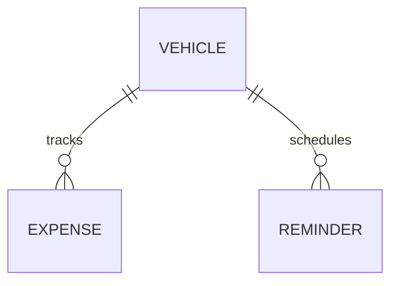
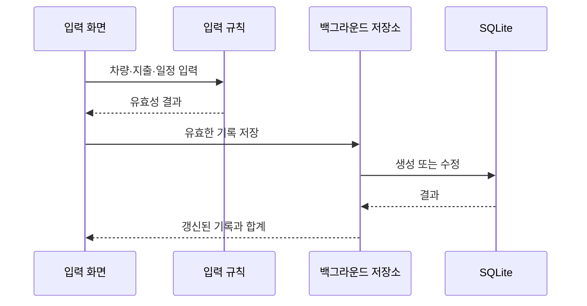

# 앱 구조

실제 프로젝트와 개발 기록을 읽어 정리한 2026-10-27 스냅샷입니다. 원본 구현 전체가 공개된 저장소는 아닙니다.

## 역할별 구성

| 원본 파일 | 책임 |
|---|---|
| ChagokActivity.kt | 홈·기록·통계·내 차와 입력·편집 동작 |
| Models.kt | 차량·지출·일정 모델, 입력 규칙과 지표 계산 |
| Insights.kt | 남은 하루 예산 등 통계 보조 계산 |
| CarStore.kt | SQLite 저장소, 백업·복원 및 데이터 입출력 |
| ReminderJob.kt | 시스템 작업으로 일정 확인과 알림 처리 |
| AdsController.kt / AdPolicy.kt | 광고 표시 연결과 빈도 제어; 공개 코드에서 제외 |

초기 제품은 Android Views 중심으로 구현되어 화면 코드가 한 Activity에 모여 있습니다. 저장소와 계산은 별도 파일로 분리되어 있지만, 완전한 계층형 모듈 구조로 표현하지 않습니다. 화면이 커지면 화면 상태와 이벤트 처리를 더 분리할 수 있습니다.

## 데이터 관계

차량 한 대를 중심으로 지출과 일정을 관리합니다. 지출 항목은 주유·충전, 정비, 보험, 세금, 주차, 통행료, 세차, 기타입니다. 일정에는 날짜 또는 목표 주행거리 중 적어도 하나가 필요합니다.

## 저장과 계산

DB와 파일 작업은 전용 백그라운드 실행기를 사용합니다. 수정은 동일 기록에 적용하고 삭제된 지출은 합계에서 제외합니다. 보험료와 세금을 가상 월할 금액으로 나누지 않고 실제 결제일의 금액으로 합산합니다.

주유 단가와 연비는 서로 다른 지표입니다. 수량이 없는 기록도 유지비에는 포함되지만 수량 기반 계산에서는 구분해야 합니다. 연비에는 가득 주유 사이의 구간을 사용하고 누락된 입력이 있는 구간을 구분합니다. 전체 연비 알고리즘은 공개하지 않습니다.

## 백업과 알림

시스템 문서 선택기로 파일을 저장하거나 선택합니다. 백업은 차량·지출·일정을 포함하고 복원은 내용 검증 후 DB 트랜잭션으로 교체합니다. 전체 저장소 접근 권한을 전제로 하지 않습니다. 원본 DB 스키마와 백업 직렬화 코드는 제외했습니다.

JobScheduler로 주기적으로 관리 일정을 확인합니다. 정확한 시각 알림을 보장하는 구조가 아니며 절전 상태와 강제 종료의 영향을 받습니다. Android 13 이상에서는 알림을 켤 때 권한을 요청합니다.

## 공개 예제와의 관계

[CarExamples.kt](../examples/CarExamples.kt)는 월 구분, 오늘을 포함한 일수, 날짜·거리 중 먼저 다가온 일정이라는 원칙을 작은 JVM 코드로 다시 작성했습니다. 실제 클래스·DB·광고 모듈·복원 형식을 재현하지 않습니다.
